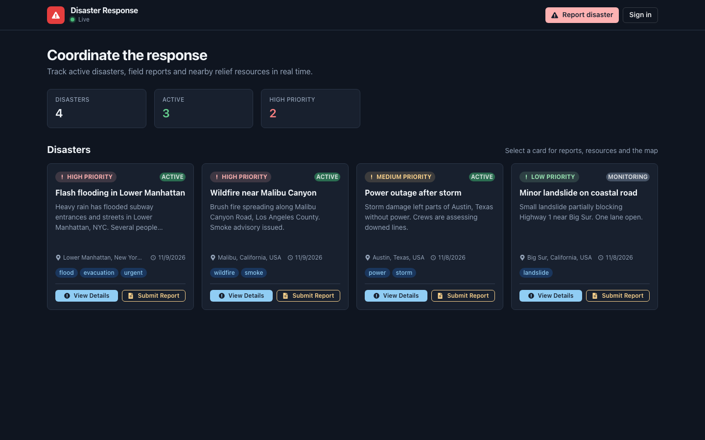
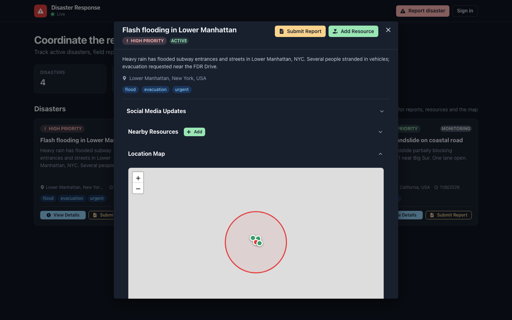
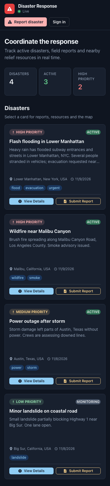

# Disaster Response Coordination Platform

A disaster-coordination dashboard built with React, Express and Supabase/PostGIS. It uses Google Gemini to extract locations and set priorities, OpenCage for geocoding, and Leaflet for maps.


## Live demo

- Frontend (Vercel): <https://disaster-response-coordination-one.vercel.app>
- The backend is configured to deploy to Render (`backend/render.yaml`). The frontend's default API URL is `https://disaster-response-coordination.onrender.com`.



## Overview

Anyone can browse disasters, reports, resources and the map. Signed-in users (Supabase Auth, email + password) can log a disaster with a free-text description. The backend sends the description to Gemini to pull out a location name and a priority level, with keyword-based fallbacks if Gemini is unavailable. It geocodes the location with OpenCage and stores the result as a PostGIS point in Supabase.

From the dashboard you can then:

- File reports, with optional Gemini image verification
- Register relief resources
- Find resources near a disaster with a PostGIS distance function
- See everything on a Leaflet map

The social media feed and the official updates (FEMA / Red Cross style) are **mock data** generated by the backend for demo purposes.

## Features

- **Accounts**: Supabase Auth sign-in/sign-up in the UI. The API verifies the Supabase access token on every write; the reporter (or an admin listed in `ADMIN_USER_IDS`) can edit or delete a disaster, and only admins can edit or delete resources
- **Disaster CRUD** with Gemini location extraction, geocoding and priority analysis on create and update (keyword fallbacks when Gemini is unavailable or not configured)
- **Reports** per disaster, with keyword-based priority (`urgent`, `emergency`, `immediate`, `critical` set `high`) and a `pending` verification status
- **Image verification** endpoint that fetches an image URL (public http(s) images only, size and time limited, private/internal addresses blocked) and asks Gemini to assess it
- **Resources** CRUD and **nearby search** by latitude, longitude and radius (great-circle distance, works with GeoJSON, EWKB or WKT locations as returned by Supabase)
- **Map view** of disasters and resources with React Leaflet
- **Mock social media feed** with filtering, high-priority posts and trending topics
- **Mock official updates** per disaster
- **Real-time updates (Socket.IO)**: the server emits `disaster_updated` (create/update/delete), `report_created` and `resource_created`; the dashboard and open report lists refresh automatically and the header shows a Live/Offline indicator
- **Dashboard UI**: summary stats, loading skeletons, empty and error states with retry, keyboard-accessible cards, responsive layout
- **Rate limiting**: 10 requests per second per client IP on `/api` (in memory, `rate-limiter-flexible`)
- **Structured logging** with Winston
- **Health check** at `GET /health`

## Tech stack

| Layer      | Technology                                                                 |
|------------|----------------------------------------------------------------------------|
| Frontend   | React 18, Vite 5, Chakra UI, React Leaflet / Leaflet, Socket.IO client, Supabase JS (auth), react-icons |
| Backend    | Node.js 22 (ES modules), Express 4, Socket.IO 4, Winston, rate-limiter-flexible |
| Database   | Supabase (PostgreSQL + PostGIS) and Supabase Auth                           |
| AI / Geo   | Google Gemini (`@google/generative-ai`, default model `gemini-2.5-flash`), OpenCage geocoding REST API |
| Testing    | Jest, Supertest, Babel                                                     |
| Hosting    | Vercel (frontend), Render (backend)                                        |

## Project structure

```
.
├── backend/
│   ├── src/
│   │   ├── app.js                 # Express app: CORS, rate limit, routes, /health
│   │   ├── server.js              # HTTP + Socket.IO entry point
│   │   ├── middleware/            # auth.js (Supabase token check), rateLimit.js
│   │   ├── routes/                # disasters, reports, resources, social-media
│   │   ├── services/              # Gemini, geocoding, Supabase, mock social/official data
│   │   ├── database/              # schema.sql, reports_schema.sql, refresh_functions.sql
│   │   ├── tests/                 # Jest tests (all external services mocked)
│   │   └── utils/                 # logger, geo parsing, SSRF-safe fetch, HTTP helpers
│   ├── test-api.sh                # curl smoke tests against a running server
│   └── render.yaml
└── frontend/
    ├── src/
    │   ├── App.jsx
    │   ├── components/            # DisasterForm, DisasterList, MapView, Reports, ReportForm,
    │   │                          # ResourceForm, OfficialUpdates, AuthModal
    │   ├── context/AuthContext.jsx
    │   ├── lib/                   # api.js (fetch helper), geo.js, supabase.js
    │   ├── services/socketService.js
    │   └── config.js              # BACKEND_URL + Socket.IO options
    └── vercel.json
```

## Getting started

### Prerequisites

- Node.js 22+ and npm (the latest `@supabase/supabase-js` requires Node 22)
- A Supabase project with the PostGIS extension enabled and the Email auth provider on
- Optional: a Google Gemini API key and an OpenCage API key (without them, keyword fallbacks are used and disasters are saved without coordinates)

### 1. Clone and install

```bash
git clone https://github.com/VamsiKrishnaThota03/disaster-response-coordination.git
cd disaster-response-coordination

cd backend && npm install
cd ../frontend && npm install
```

### 2. Set up the database

In the Supabase SQL editor, run `backend/src/database/schema.sql`. It enables PostGIS and creates the tables, indexes and geospatial functions, and is safe to re-run. `reports_schema.sql` drops and recreates the `reports` table; `refresh_functions.sql` recreates `find_resources_within_distance`.

### 3. Environment variables

**Backend** (`backend/.env`, see [`backend/.env.example`](backend/.env.example)):

| Variable            | Required | Description |
|---------------------|----------|-------------|
| `SUPABASE_URL`      | yes | Supabase project URL |
| `SUPABASE_ANON_KEY` | yes | Supabase anon key (also used to verify users' access tokens) |
| `GEMINI_API_KEY`    | no  | Google Gemini API key |
| `GEMINI_MODEL`      | no  | Gemini model (default `gemini-2.5-flash`) |
| `OPENCAGE_API_KEY`  | no  | OpenCage geocoding key |
| `CORS_ORIGINS`      | no  | Comma-separated allowed browser origins (default: the Vercel app and `http://localhost:5173`). `FRONTEND_URL` is also accepted |
| `ADMIN_USER_IDS`    | no  | Comma-separated Supabase user IDs allowed to edit/delete any disaster and manage resources |
| `AUTH_DISABLED`     | no  | `true` treats every request as a signed-in admin. **Local development only** |
| `PORT` / `HOST`     | no  | Default `3001` / `127.0.0.1` (`0.0.0.0` automatically on Render) |
| `RATE_LIMIT_PER_SECOND` | no | Requests per second per IP on `/api` (default `10`) |
| `LOG_TO_FILE`       | no  | `true` to also write `error.log` / `combined.log` |

**Frontend** (`frontend/.env`, see [`frontend/.env.example`](frontend/.env.example)):

| Variable                 | Description |
|--------------------------|-------------|
| `VITE_BACKEND_URL`       | Backend base URL. Defaults to `http://localhost:3001` in dev and the Render URL in production builds |
| `VITE_SUPABASE_URL`      | Supabase project URL, for sign-in |
| `VITE_SUPABASE_ANON_KEY` | Supabase anon key (public by design) |

Without the two Supabase variables the app still works read-only and the sign-in dialog explains what is missing.

### 4. Run

```bash
# Terminal 1
cd backend
npm run dev        # nodemon; use `npm start` for plain node

# Terminal 2
cd frontend
npm run dev
```

Open <http://localhost:5173>.

### Tests and checks

```bash
cd backend
npm test           # Jest (with coverage report)
npm run test:api   # curl smoke tests against http://localhost:3001

cd ../frontend
npm run lint
npm run build
```

`npm test` mocks Supabase, Gemini and OpenCage, so it needs no credentials. `test:api` creates data, so start the server with `AUTH_DISABLED=true` or pass `TOKEN=<supabase access token>`.

<p>
  
  
</p>

## API

Base URL: `http://localhost:3001`. `GET` routes are public. `POST`, `PUT` and `DELETE` routes need `Authorization: Bearer <Supabase access token>`; editing/deleting a disaster needs its owner or an admin, and `PUT`/`DELETE /api/resources/:id` need an admin.

| Method | Path                                      | Purpose                                                       |
|--------|-------------------------------------------|---------------------------------------------------------------|
| GET    | `/health`                                 | Health check                                                  |
| GET    | `/api/disasters`                          | List disasters                                                |
| POST   | `/api/disasters`                          | Create a disaster `{ title, description, type?, severity?, tags? }` (owner = signed-in user) |
| GET    | `/api/disasters/:id`                      | Get a disaster                                                |
| PUT    | `/api/disasters/:id`                      | Update a disaster (re-extracts and geocodes the location)     |
| DELETE | `/api/disasters/:id`                      | Delete a disaster                                             |
| GET    | `/api/disasters/:id/resources?radius=`    | Resources within `radius` metres of the disaster (default 10000) |
| POST   | `/api/disasters/:id/verify-image`         | Gemini image verification `{ image_url }`                     |
| GET    | `/api/disasters/:id/reports`              | Reports for a disaster                                        |
| POST   | `/api/disasters/:id/reports`              | Create a report `{ content, image_url?, user_id? }`           |
| GET    | `/api/disasters/:id/official-updates`     | Official updates (mock data)                                  |
| GET    | `/api/reports/disaster/:disasterId`       | Reports for a disaster                                        |
| POST   | `/api/reports`                            | Create a report                                               |
| GET    | `/api/resources/nearby?latitude=&longitude=&radius=` | Resources near a point                             |
| POST   | `/api/resources`                          | Create a resource `{ name, type, location_name, latitude, longitude, status, disaster_id }` |
| PUT    | `/api/resources/:id`                      | Update a resource                                             |
| DELETE | `/api/resources/:id`                      | Delete a resource                                             |
| GET    | `/api/social-media/disaster/:disasterId`  | Mock social media posts (`keywords`, `timeframe` query)       |
| GET    | `/api/social-media/priority/:disasterId`  | High-priority mock posts                                      |
| GET    | `/api/social-media/trends/:disasterId`    | Trending topics from the mock posts                           |

## Known limitations

- Social media posts and official updates are generated mock data, not live feeds.
- Rows created before sign-in was added have `owner_id` values like `system` or `netrunnerX`; only admins (`ADMIN_USER_IDS`) can edit or delete them.
- The backend talks to Supabase with the anon key, so Row Level Security policies must allow the anon role to read and write these tables (as before). Authorization is enforced in the API.
- The rate limiter and the Gemini priority cache are in memory and per instance.
- Image verification checks the resolved address before fetching, but does not pin it for the connection itself (a DNS-rebinding attacker could still race it).
- The production bundle is about 780 kB (Chakra UI + Leaflet) and is not code-split yet.
